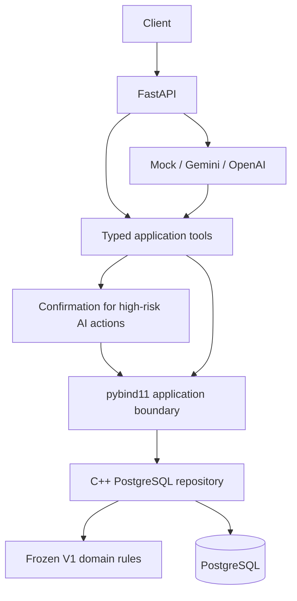

# LibraCore V2 — Persistent C++ Resource, Acquisition and Lending Engine

LibraCore combines a C++17 domain engine, PostgreSQL storage, Python bindings,
FastAPI, and a controlled AI assistant. Physical and digital resources share
inventory; departmental budgets remain independent. The frozen V1 pricing,
Money, quotas, acquisitions, cancellation and lending algorithms remain the
business authority.

**Release status:** implementation delivered for local database verification.
The PostgreSQL adapter and Python extension compile; offline tests pass.
Docker-backed tests and persistent benchmarks have not run in the delivery
workspace. Do not freeze V2 until `./scripts/test_v2.sh` succeeds in WSL.
See [completion report](docs/V2_COMPLETION_REPORT.md) for exact evidence.

## Architecture



Python validates request shape and orchestrates. C++ calculates prices, taxes,
quotas, refunds and lending state. PostgreSQL stores authoritative records and
commits all effects together. SQL is confined to the persistence layer; Python
SQL is limited to migration/test administration. AI never receives a database
connection or confirmation tool.

## Functionality

- Books, Journals, Theses, ElectronicResources, EBooks and AudioBooks; normalized
  authors, identifiers and subtype metadata.
- Exact integer-minor-unit Money, normalized currencies and mixed-currency
  protection; hardcover/bulk/seat pricing and configurable taxes.
- Vendors and offers; cheapest, fastest and highest-rated selection with V1 ties.
- Purchases, rejection history, cancellation, independent/atomic batches,
  department budgets, unit/spend/title quotas and fiscal rollover.
- Persistent users; borrower-aware loans, due dates, partial/full returns.
- Database search with AND filters, deterministic sorting, pagination and
  PostgreSQL full-text search. No full-catalog Python filtering.
- Budget/category/utilization, acquisition and lending summaries; append-oriented
  purchase and audit history.
- Transaction rollback, serialized cross-process writes and idempotency receipts.
- Mock/Gemini/OpenAI intent interpretation, typed tools and single-use confirmation.

Original academic filenames (`MT26076_*`), `BookManagement` CMake project name,
Q1–Q16 examples and `bookmgmt` namespace are retained for compatibility.
The exact resource hierarchy remains documented in [V1 README](docs/V1_README.md).

## WSL setup

Use Ubuntu 24.04 inside WSL2 with Docker Desktop's Ubuntu integration enabled.
Keep the project under the Linux filesystem, for example `~/projects/LibraCore`.

```bash
sudo apt-get update
sudo apt-get install -y build-essential cmake python3 python3-venv python3-dev \
  libpq-dev libpqxx-dev nlohmann-json3-dev pkg-config unzip
cd ~/projects/LibraCore
./scripts/setup_v2.sh
./scripts/test_v2.sh
```

These are PostgreSQL **client/development** packages. The server runs only in
Docker Compose. Setup preserves an existing `.env`, creates it from `.env.example`
only if absent, builds C++/pybind11, starts PostgreSQL, migrates development/test
DBs and seeds six representative resources. Python dependencies are pinned in
`requirements-lock.txt`; the package is installed into `.venv`.

If your uploaded secret file downloaded as `.env(1)`, copy it locally to the
project's `.env` before setup. Never include it in source control or shared ZIPs.
See [complete local procedure](docs/V2_LOCAL_VERIFICATION.md).

## Configuration and AI

Configuration precedence: environment variables → `.env` → `.env.example` →
typed development defaults. Empty database URLs are derived from `POSTGRES_*`.
Explicit `DATABASE_URL` / `TEST_DATABASE_URL` override derivation. Keep them
consistent with Docker settings. Model names belong in configuration, not code.

- `LLM_PROVIDER=auto`: nonempty OpenAI key → OpenAI; otherwise Gemini key → Gemini;
  otherwise Mock. A selected live provider also requires its model name.
- `LLM_PROVIDER=gemini`, `openai` or `mock`: explicit selection; no silent fallback.
- `AI_ENABLED=false`: API/domain functionality works without an AI provider.
- `AI_WRITE_ACTIONS_ENABLED=false`: all AI writes rejected.
- `AI_REQUIRE_CONFIRMATION=true`: every AI purchase and cancellation requires a
  proposal token followed by a separate client confirmation request.
- `LLM_FALLBACK_ON_ERROR=false`: provider failures are structured errors. Enabling
  runtime fallback is currently rejected rather than silently changing provider.

No OpenAI key is required. Normal tests force Mock and block live SDK clients,
including when credentials exist in `.env`. A separate live smoke script is
explicitly opt-in and performs interpretation only, with no domain write.

## API and demo

```bash
./scripts/demo_v2.sh
```

Open `http://127.0.0.1:8000/docs` (or your configured port). API routes use
`/api/v1`; product version V2 is independent of API version v1. `/health` checks
C++ and PostgreSQL without calling an LLM. See [API contracts](docs/V2_API.md).

The original console demo remains available as `./build-v2/demo`.

## Tests and benchmarks

```bash
./scripts/test_v2.sh                  # complete suite; resets ONLY libracore_test
./scripts/test_offline.sh             # offline subset after building bindings
./build-v2/bookmgmt_tests
./build-v2/bookmgmt_fault_tests
./build-v2/bookmgmt_benchmark 10000
./build-v2/bookmgmt_benchmark 100000
./build-v2/bookmgmt_benchmark 1000000
./scripts/benchmark_v2.sh 10000        # resets libracore_test; never development DB
./scripts/benchmark_v2.sh 100000
```

The fault suite preserves seven V1 transaction scenarios and 58 allocation-failure
points. New database tests inject SQL failures after state updates, race separate
connections and verify full-stack behavior. Test DB name must be `libracore_test`,
distinct from development. Do not run tests concurrently against the same test DB.

Database benchmarks print actual generation, lookup, title/author/combined/year,
full-text/pagination and purchase/borrow timings plus consumed result counts.
They use the same C++ application as the API. No DB timing is claimed before local
execution. Historical V1 timings are in [V1 documentation](docs/V1_README.md).

> Benchmark results are environment-specific and are intended for comparative
> project evaluation rather than universal performance claims.

## V1-only build

The original engine remains independent of PostgreSQL and Python:

```bash
cmake -S . -B build
cmake --build build --parallel
ctest --test-dir build --output-on-failure
./build/demo
```

Enable V2 with `-DLIBRACORE_V2=ON`; setup supplies the pybind11/Python paths.

## Intentional boundaries

This is a modular backend with no substantial frontend, authentication or public
hosting configuration. Run it on trusted localhost. User roles are stored domain
metadata, **not authorization**. REST writes are direct client operations; the
confirmation policy applies to AI tools. A global DB row serializes application
changes; transaction history/budget hydration favors correctness over high write
throughput. Confirmation proposals are bounded, short-lived in-memory state and
require one API worker. PostgreSQL is persistent; pending confirmations disappear
on restart. History is currently unbounded. Cross-currency aggregate financial
reports reject mixed currencies, following V1 Money semantics. No exchange rates,
vector embeddings, pgvector or semantic retrieval are required. Those remain
future V2.x work. Fiscal-year rollover closes prior-year cancellation; prior
records remain immutable. API timestamps normalize to UTC, with second precision
in the C++ mapping and supported external years 1970–2200.

## Documentation

- [Architecture and transaction design](docs/V2_ARCHITECTURE.md)
- [Database schema and migrations](docs/V2_DATABASE_SCHEMA.md)
- [REST and binding contracts](docs/V2_API.md)
- [AI providers, tools and confirmations](docs/V2_AI_DESIGN.md)
- [Testing strategy](docs/V2_TESTING.md)
- [WSL local verification](docs/V2_LOCAL_VERIFICATION.md)
- [Completion report and remaining verification](docs/V2_COMPLETION_REPORT.md)

No commit, push or Git tag is created by setup or tests.
