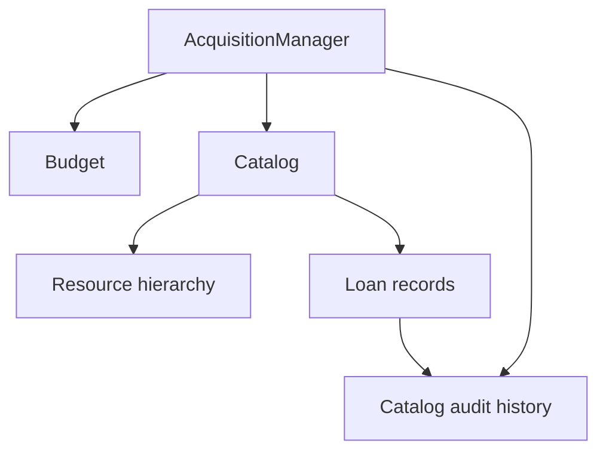

# LibraCore V1 — C++ Resource, Acquisition and Lending Engine

**Release: LibraCore V1.0 (v1.0.0)**

LibraCore is a standalone C++17 resource-management domain engine for physical
and digital library resources. It coordinates acquisition, resource-specific
pricing, vendors, taxes, budgets, category and title quotas, department budgets,
cancellation, lending, search, structured reporting, currency-aware Money and
event history. Synthetic benchmarks exercise catalog operations up to one
million resources. It has no third-party runtime dependencies.

## Important V1 features

- Books, Journals, Theses, EBooks, AudioBooks and licensed electronic resources.
- Hardcover/bulk/subscription/seat pricing, configurable taxes, cheapest/fastest/
  highest-rated vendors, requests, purchases and all-or-nothing batches.
- Overall and departmental budgets, quotas, distinct-title limits, refunds and rollover.
- Combined search with six sort modes; holdings, named borrowers, due dates and returns.
- Structured summaries, utilization, currency-preserving fixed-point Money and audit events.
- Assertion-based regression tests, allocation-failure rollback tests and scalable data generation.

## Naming and academic compatibility

The portfolio identity is **LibraCore V1.0**. Internal `BookManagement` CMake
project naming, `bookmgmt` targets/namespace, `MT26076_*` source/header names,
original Q1–Q16 demo labels and `ANSWERS.md` are retained for academic
compatibility. Includes and source filenames have not been renamed.

## Build and run

Requires a C++17 compiler and CMake 3.14 or later.

```sh
cmake -S . -B build
cmake --build build --parallel
ctest --test-dir build --output-on-failure
./build/bookmgmt_tests
./build/bookmgmt_fault_tests
./build/demo
./build/bookmgmt_benchmark 10000
./build/bookmgmt_benchmark 100000
./build/bookmgmt_benchmark 1000000
```

Windows CMD with MinGW (such as MSYS2 UCRT64) and CMake on PATH:

```bat
cmake -S . -B build -G "MinGW Makefiles"
cmake --build build --parallel
build\bookmgmt_tests.exe
build\bookmgmt_fault_tests.exe
build\demo.exe
build\bookmgmt_benchmark.exe 100000
```

For MSVC, use its Developer Command Prompt, omit `-G`, build with
`--config Debug`, and run from `build\Debug`. Windows commands are documented,
but verification was performed on Linux. All targets enable warnings
(`-Wall -Wextra -Wpedantic` or `/W4`). Both test executables retain assertions
in Release builds. Benchmarks do not run in CTest. To measure optimized code,
configure a separate directory with `-DCMAKE_BUILD_TYPE=Release`.

### Tests

`./build/bookmgmt_tests` runs 26 test functions, including the original 18.
`./build/bookmgmt_fault_tests` injects allocation failures into purchase,
cancellation, borrow, return, submit and atomic-batch operations, checking that
failed transactions do not partially alter budgets, holdings, loans or history.
`ctest --test-dir build --output-on-failure` runs both executables.

### Demo

`./build/demo` retains the original resource/pricing/budget demonstrations and
adds combined and sorted search, borrower/due-date records, all three vendor
modes, structured reports, explicit currency display and actual audit events.

### Benchmarks

`./build/bookmgmt_benchmark 10000`, `100000` or `1000000` runs separately from
the normal tests. Exact operation labels and measured timings appear below.

## Architecture



| Component / files | Responsibility |
|---|---|
| Resource hierarchy | Metadata, resource-specific pre-tax pricing, vendor offers |
| Money.h / Validation.h | Checked fixed-point amounts, currency validation, nonblank IDs |
| Catalog.h / Catalog.cpp | Resource ownership, holdings, combined queries and sorting |
| Lending.h / Lending.cpp | Loan operations implemented on Catalog to preserve one availability invariant |
| Budget | Allocation, post-tax quotas, distinct titles, refunds, rollover, utilization |
| AcquisitionManager | Request preparation, taxes, vendor choice, staged commits, cancellation and batches |
| History.h | Purchase, cancellation, borrow and return events |
| Structured summaries | Values exposed by Budget, Catalog and AcquisitionManager |

### Resource hierarchy

`Resource` subclasses are `Book`, `Journal`, `Thesis`, and `ElectronicResource`.
`EBook` and `AudioBook` derive from `ElectronicResource`. Thesis keeps the Book
category and AudioBook the ElectronicResource category for quota compatibility.

| Class | Direct parent |
|---|---|
| Book | Resource |
| Journal | Resource |
| Thesis | Resource |
| ElectronicResource | Resource |
| EBook | ElectronicResource |
| AudioBook | ElectronicResource |

`VendorOffer` stores vendor metadata and unit price; `Loan` stores borrowing
state and dates; `PurchaseRecord` and `Event` expose transaction/action history.
`BudgetSummary`, `CategorySummary`, `DepartmentSummary`, `AcquisitionSummary`
and `LendingSummary` expose reporting values without parsing printed text.

## Search

```cpp
SearchQuery q;
q.category = ResourceCategory::Book;
q.author = "Martin";
q.fromYear = 2000;
q.sort = SearchSort::YearDescending;
auto matches = catalog.search(q);
```

Filters combine with AND. Title and author are case-insensitive substrings;
identifier is an exact case-insensitive ISBN/ISSN match. Year boundaries are
inclusive and may be one-sided. A blank query matches all resources. Legacy
search methods remain available. Sorting supports title, year and listed unit
price in both directions, with ascending ID as the final tie-breaker.
Mixed-currency price sorting throws; default order is resource ID.

Catalog uses `std::map`: lookup is O(log N), filtering O(N), sorting O(M log M)
for M results. Searches return `const Resource*` pointers valid until removal
or Catalog destruction, without exposing its internal container.

## Lending

```cpp
Catalog catalog(LendingConfig{14});
// Add a resource and holdings first.
auto l = catalog.borrow("B001", "student-42", 2);
catalog.returnBorrowed(l.loanId, 1); // partial return
catalog.returnLoan(l.loanId, std::chrono::system_clock::now()); // full remainder
```

Records include loan/resource/borrower IDs, original and returned quantities,
borrow and due instants, optional final return instant, and Active/Returned status.
`activeLoans`, `loansForUser`, `loansForResource` return value copies.
Electronic resources use the same model for licensed sessions.

`borrow` accepts an explicit borrow timestamp and optional due timestamp.
The default duration is configurable from 1 to 36,500 days. A day is 24 elapsed
hours, not a local-calendar day; no timezone/DST or fines policy is introduced.
Due dates must follow borrow dates. Partial returns preserve original quantity;
`returnDate` is populated when all units are returned.

Legacy `lend(resourceId, units)` creates anonymous records. Legacy
`returnLoan(resourceId, units)` can return anonymous loans only. Named loans
require `returnBorrowed(loanId, units)` or the timestamp overload shown above.
This avoids ambiguity between resource IDs and loan IDs in one-string calls.
Resources with outstanding loans cannot be removed.

## Acquisition, configuration and vendors

```cpp
book.addVendor({"Campus Books", Money::of(80), "campus", 4.5, 7});
book.addVendor({"Express Books", Money::of(100), "express", 4.8, 1});
AcquisitionManager acq(catalog, budget); // cheapest, zero tax by default
acq.setConfig({{10, 20}, VendorSelection::Cheapest});
auto price = acq.quote("B001", 2, VendorSelection::Fastest);
PurchaseRequest request{"B001", 2, "Computer Science"};
request.vendorSelection = VendorSelection::Fastest;
auto result = acq.submit(request);
```

Register departments with `addDepartment` before use. Empty department means
default budget. Nonempty IDs/names must have a non-whitespace character; values
are not trimmed or renamed. Mutations validate IDs; lookup predicates `find`
and `contains` tolerate absent/blank keys. Numeric order IDs must be positive.

Vendor IDs are unique per resource. Rating must be finite in 0..5; delivery days
and price must be nonnegative, and currency must match the resource.
Legacy `addVendor(name, price)` uses the name as ID, rating 0 and delivery days 0.
Zero delivery days means zero for ranking, not unknown; provide realistic
metadata when using fastest selection.

| Mode | Comparison order |
|---|---|
| Cheapest | price ascending, rating descending, days ascending, ID ascending |
| Fastest | days ascending, price ascending, rating descending, ID ascending |
| HighestRated | rating descending, price ascending, days ascending, ID ascending |

Without offers, listed price applies. Original hardcover (20%), bulk print
(10% at 10+ copies), journal subscription, and electronic-seat rules (seats
beyond 50 half price) still apply. Tax rates are nonnegative integer percentages.
All amount and intermediate percentage calculations reject arithmetic overflow.

A request starts Requested; `submit` updates status, reason and order number.
Processed requests cannot be resubmitted. Batch inputs stay const and outcomes
are returned, retaining the old API. Direct `purchase` throws without recording
validation failures; `submit` and `processBatch` record rejected requests.

History records describe actions: an Approved purchase remains Approved, and
cancellation appends a Cancelled record referencing it. `orderStatus(orderNo)`
reports current state. Legacy `approved` is true for successful purchase and
cancellation actions. Cancellation refunds the exact original charge and
preserves department and vendor metadata even if prices change.

Catalog and Budget must outlive their AcquisitionManager. Copy returned order
records or store order numbers before further mutations; history references
may be invalidated by later transactions.

## Transaction safety and history

Purchase, cancellation and atomic batch operations stage budgets, holdings,
history and events before committing via swaps and integer assignments.
Budget staging uses object identity, so department aliases of one budget share
the same cumulative limit. Lending similarly stages loan and event changes.
Invalid operations and allocation failures preserve live state. The isolated
fault test exercises seven workflows at every allocation point until success.
Non-atomic batches intentionally commit one request at a time.

`catalog.events()` combines successful Purchase, Cancellation, Borrow and Return
actions from its managers. Events contain resource, quantity, actor (borrower
or department), recording timestamp and loan/order reference. Results sort by
recording time and preserve insertion order for ties. Historical loan dates
are distinct from audit recording times. Rejections remain in acquisition
history, not successful-action events. Order IDs are manager-local; use one
manager per catalog for unambiguous order references.

## Structured reports and Money

- `Budget::summary`: total, spent, remaining, percentage used.
- `Budget::categorySummary`: units/titles/spend used and remaining, utilization.
- `AcquisitionManager::departmentSummaries`: default budget followed by named departments.
- `AcquisitionManager::summary`: approved purchase actions, rejected requests,
  cancellation actions, and net pre/post-tax totals after refunds.
- `Catalog::lendingSummary`: holdings, borrowed, available and active-loan count.

Approval counts include subsequently cancelled purchases: counts describe
historical actions, not disjoint current orders. Missing quotas return `nullopt`
for remaining allowances/utilization. Zero unused limits return 0%; quotas
cannot be reduced below current usage. Multi-currency histories are possible,
but aggregate Money totals reject mixed currencies. Department summaries retain
individual currencies. No currency conversion is supplied.

`Money::toString` and stream output remain numeric-only. `toCurrencyString`
returns e.g. `INR 1250.00`. Currency codes normalize to uppercase; invalid codes
and mixed-currency operations throw. Signed 64-bit minor-unit arithmetic is checked.

## Benchmark results

Measured on 24 October 2026 after the final clean build. All timings are in
milliseconds; each dataset was measured once. ID lookup is 10,000 calls;
the four searches are one query each. Data generation and ID-string preparation
are outside query timers. The generation timer stops before console output.

| Dataset | Generation | 10K ID lookups | Title search | Author search | Combined search | Year range |
|---:|---:|---:|---:|---:|---:|---:|
| 10,000 | 24.709 | 6.125 | 4.750 | 1.858 | 4.807 | 1.062 |
| 100,000 | 268.512 | 12.339 | 54.594 | 22.209 | 51.026 | 13.914 |
| 1,000,000 | 2834.960 | 15.440 | 531.468 | 197.178 | 518.135 | 128.449 |

GCC 13.3.0; CMake 4.4.4; Linux 6.18.55 x86_64; AMD EPYC 9V74 80-Core Processor (virtualized environment). CMake build type unset; no optimization flag added.

> Benchmark results are environment-specific and are intended for comparative project evaluation rather than universal performance claims.

The generator creates the requested number of resources with deterministic
unique IDs. Duplicate IDs are rejected by Catalog, and generator counts and
uniqueness are tested. Queries use `std::chrono::steady_clock`; match counts
are printed so results are consumed. The workload uses all-hit ID lookups and
fixed synthetic queries, not a randomized production workload. Raw results and
match counts are in `docs/release-v1.0/final-benchmark-*.txt`.

## Verification records

`tests/` groups all 18 original test functions and V1 tests by responsibility.
`docs/COMPLETION_REPORT.md` retains the initial implementation report.
`docs/RELEASE_FREEZE_REPORT.md` records the final stabilization review, with
new baseline/final logs under `docs/release-v1.0/`. Earlier logs are historical. `ANSWERS.md` is retained as
historical assignment documentation, not the current V1 API reference.

Benchmarks accept 1..1,000,000 resources, mixing Books, Journals and electronic
resources with deterministic unique IDs. They report generation, 10,000 ID
lookups, title, author, combined and year-range searches using `steady_clock`.
They are single-run synthetic measurements, not production guarantees. Normal
tests generate only 1,003 resources; no generated datasets are saved.

## Current V1 Limitations

V1 is intentionally **in-memory, single-process, C++ only and non-persistent**.
It has no authentication, database storage or AI integration. It is single-threaded;
callers must synchronize concurrent access. Loan/history retention is unbounded.
Transaction staging copies favor clarity and exception safety over high-volume
write throughput; search benchmarks do not measure large-history transactions.
These are V1 scope boundaries. Later versions are planned to introduce persistence
and Python/AI integration.

## Version roadmap

| Version | Focus | Status |
|---|---|---|
| V1 | Standalone C++ domain engine | COMPLETE |
| V2 | Persistence + Python/AI | PLANNED |
| V3 | Scale / distributed system | PLANNED |

## Manual release tag

After committing the reviewed release files in your own Git repository, you can
run these commands manually. This stabilization pass does not create a tag or push.

```sh
git tag -a v1.0.0 -m "LibraCore V1 C++ core"
git push origin v1.0.0
```
