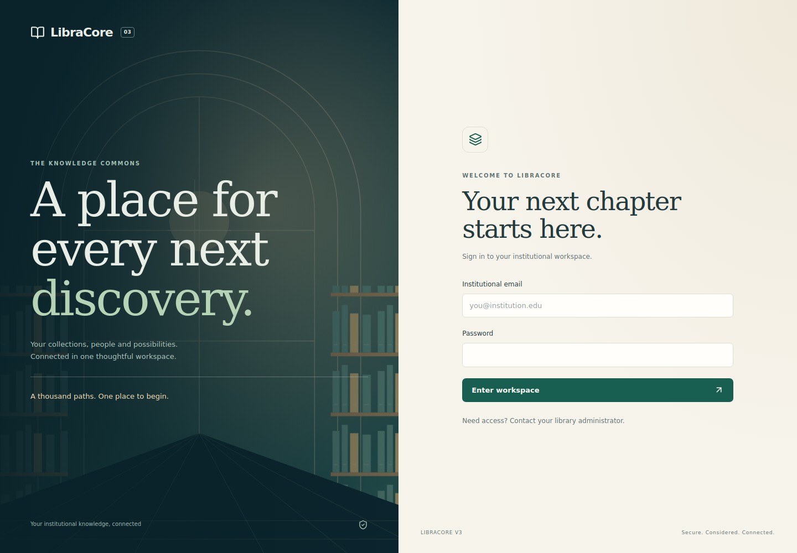
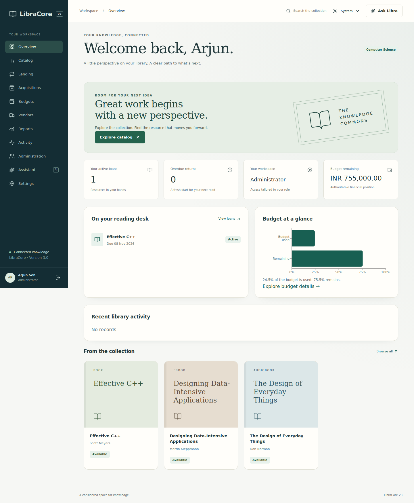
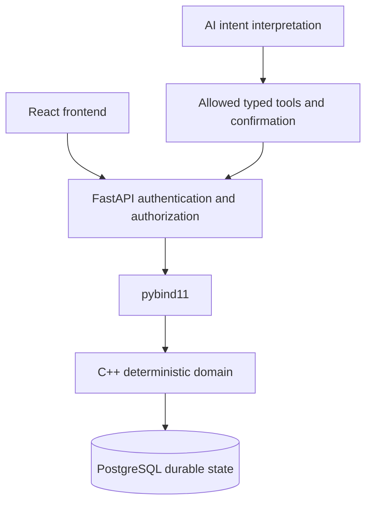

# LibraCore V3 — A connected library workspace

LibraCore is a resource, acquisition and lending application with a deterministic C++17 core. V3 adds a responsive role-aware React interface, server-side authentication, authorization and a controlled AI assistant to the PostgreSQL-backed V2 engine. This polish pass preserves the V1 domain algorithms and extends the existing repository/API contracts without changing financial calculations.

**Release status: V3 polish prepared for final local regression. See the [polish report](docs/V3_POLISH_REPORT.md) for measured results, screenshots and checks requiring PostgreSQL/Docker.**





Screenshots are actual UI captures with documented browser test fixtures; they are not evidence of a live database run. [Screenshot provenance](docs/screenshots/README.md).

## From domain engine to application

| Release | Responsibility |
|---|---|
| V1 — frozen | C++17 physical/digital resources, currency-aware Money, pricing, taxes, vendors, budgets/quotas, acquisition/cancellation, lending, search, reporting and event history |
| V2 — frozen | PostgreSQL transactions, persistent repositories, pybind11, FastAPI and Mock/Gemini/OpenAI typed tools |
| V3 | Authentication, authorization, responsive product UI, scoped AI, pooling/cursor pagination, security/observability, CI and production-style containers |

The original assignment-compatible source names remain intentionally intact. Portfolio identity is LibraCore; keeping those filenames preserves submission/include compatibility. Historical documentation lives in [V1 README](docs/V1_README.md), [V2 README](docs/V2_README.md) and the V2 architecture documents.

## Authority remains explicit



AI interprets intent. The frontend presents results. Python authenticates and orchestrates. C++ determines prices, taxes, quotas, budgets, lending and acquisition outcomes. PostgreSQL persists the transaction. Neither JavaScript nor an LLM becomes a second financial authority.

## Product workflows

- Search by exact resource ID, ISBN or ISSN and by title, author or publisher, with stable sorting and availability filters. ID browsing uses cursor pagination; ranked text searches use offset pagination.
- Browse type-specific metadata and readable currency/status values. Authorized staff create resources with explicit opening stock, and upload, replace or revert optional Book covers.
- Borrow and partially/full return resources, track due dates and view loan history.
- Preview acquisition costs, selected vendor and budget/quota impact; confirm purchases and cancellations.
- Review budget utilization, categories, operational reports and immutable events.
- Manage users, departments, roles and credentials with immediate session revocation.
- Ask Libra through Mock, Gemini or OpenAI; only permitted tools are offered, and high-risk actions require separate human confirmation.
- Switch Light/Dark/System themes and use the same workflows on desktop, tablet or mobile.

## Roles

Students and Faculty access the catalog and their own loans. Librarians manage collections, lending, vendors and permitted acquisitions. Department Managers handle their own department's finance/acquisitions. Administrators manage institutional access. Permissions are enforced server-side for both HTTP and AI, not merely by hiding navigation.

## Run locally

WSL2 Ubuntu 24.04, Docker Desktop with WSL integration, C++17/CMake/Python 3.12 development packages and Node 22 are the supported local setup. Start with the step-by-step [SETUP guide](SETUP.md); detailed regression commands are in [local verification](docs/V3_LOCAL_VERIFICATION.md).

```bash
cd ~/projects/LibraCore-V3
./scripts/setup_v3.sh
./scripts/demo_v3.sh   # first demo only: choose local demo credentials
# Later sessions, after stopping the demo terminal:
./scripts/start_v3.sh
```

Open `http://localhost:5173`. Demo setup prompts for a local-only password and provides Student, Faculty, Librarian, Manager and Administrator accounts. It uses Mock AI. Daily startup starts/waits for PostgreSQL, applies migrations safely and starts API/web without resetting or reseeding. Ctrl+C stops API/web; `./scripts/stop_v3.sh` stops PostgreSQL while retaining data. Existing `.env` files are preserved; no password or API key ships in this repository.

## Build and test

The original standalone engine still builds independently:

```bash
cmake -S . -B build
cmake --build build
./build/bookmgmt_tests
./build/bookmgmt_fault_tests
./build/demo
```

For V3:

```bash
./scripts/test_v3_offline.sh   # all checks that do not require PostgreSQL
./scripts/test_v3.sh           # real DB + browser journey checks
./scripts/benchmark_v3.sh 10000
./scripts/benchmark_v3.sh 100000
```

V1 benchmarks remain available at 10K, 100K and 1M. Database benchmark generation and query times are separate; all results are counted. Timings are environment-specific comparative evidence, not universal performance claims.

## Security and deployment

Opaque server-side sessions, Argon2id passwords, CSRF/Origin checks, central permissions, scoped ownership, session revocation, security headers and bounded rate limiting establish the V3 application boundary. Production uses Secure HttpOnly cookies and requires HTTPS. There is no public registration or automatic live AI test traffic.

```bash
docker compose -f docker-compose.prod.yml build
docker compose -f docker-compose.prod.yml up -d
```

Read [deployment](docs/V3_DEPLOYMENT.md) before using those commands: provide secrets, an HTTPS origin, TLS termination, backups and an administrator. The web service binds localhost; no public cloud deployment is performed automatically.

## Documentation

[Architecture](docs/V3_ARCHITECTURE.md) · [Authentication](docs/V3_AUTHENTICATION.md) · [Authorization](docs/V3_AUTHORIZATION.md) · [Frontend design](docs/V3_FRONTEND_DESIGN.md) · [API changes](docs/V3_API_CHANGES.md) · [Security](docs/V3_SECURITY.md) · [Testing](docs/V3_TESTING.md) · [CI/CD](docs/V3_CI_CD.md) · [Deployment](docs/V3_DEPLOYMENT.md) · [Local verification](docs/V3_LOCAL_VERIFICATION.md) · [Completion report](docs/V3_COMPLETION_REPORT.md) · [Architecture decisions](docs/adr/)

## Intentional boundaries

V3 remains a modular monolith with one API worker, process-local confirmation/rate-limit state and conservative native write serialization. It has no Kubernetes, Kafka, Redis, Elasticsearch, microservices, MFA or external identity federation. Transcript persistence is deferred. These boundaries are documented so later work can evolve deliberately rather than silently changing the core's semantics.

## V3 polish notes

Original bundled SVG artwork and covers require no external image service. Validated raster covers live in durable local media storage, separate from financial data. Migration 004 adds cover metadata; migrations 001–003 retain their original checksums. Back up PostgreSQL **and** media before upgrading.

The default configuration uses `LLM_PROVIDER=auto` and the locally tested `GEMINI_MODEL=gemini-2.5-flash`; keys are optional and configurable. No credentials selects Mock. A live provider failure is reported explicitly and never silently converted into a Mock success. Automated tests explicitly use Mock.

See [polish engineering notes](docs/V3_POLISH_ENGINEERING.md), [file inventory](docs/V3_POLISH_FILE_INVENTORY.md) and [completion/verification report](docs/V3_POLISH_REPORT.md).
