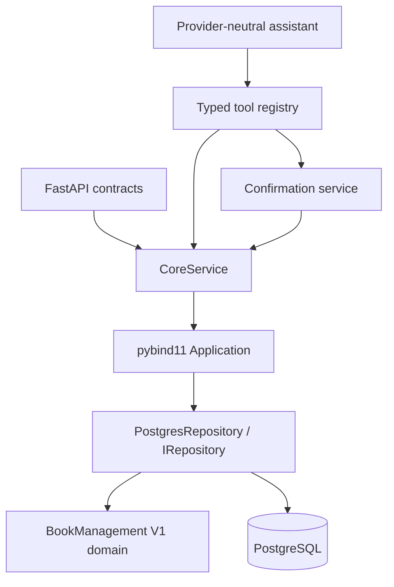

# V2 architecture

## Responsibilities and dependency direction

`IRepository` exposes named application operations and structured values, not SQL.
`PostgresRepository` implements the relational unit of work. One aggregate
repository is intentional: budget, inventory, purchase history and audit events
must share a transaction. It is not six repositories with unrelated transactions.
Its internal helpers own resource mapping, budget hydration, loan writes,
append-only records and search. All authoritative pricing/validation remains in
`AcquisitionManager`, `Budget`, `Catalog` and the Resource subclasses.

`Mapping.cpp` is the boundary codec. JSON transports typed data through bindings
and `jsonb_populate_record`; financial/loan/catalog state is stored in relational
columns, not opaque JSON snapshots. The only V1 header change is a friend
declaration for `PersistenceAccess`. No V1 algorithm implementation was changed.
The friend is a trusted adapter, not an exposed Python state-edit API: it restores
exact budget usage, counters, holdings, loans and historical records from DB
rows without replaying current prices or generating duplicate historical events.

## Transaction lifecycle

Each call opens one RAII libpqxx connection and transaction. There is no process
cache of authoritative state. The connection sets UTC, a 10-second lock timeout
and 30-second statement timeout. Critical operations acquire `app_state(id=1)
FOR UPDATE` before reading domain state. Thus different processes see the last
committed holdings, budget and cancellation state. Search is a repeatable-read
SQL snapshot without the global write lock.

For purchases, cancellation, borrowing, returning and batches:

1. Lock the application row and check an optional idempotency receipt.
2. Load resource rows needed by the operation, their loans, budgets/usage/quotas,
   and acquisition history into transaction-local V1 objects.
3. Execute V1 domain behavior. In-memory exception safety is preserved.
4. Write changed holdings, budgets, loan returns, new purchase records and events;
   update counters and store the idempotency result.
5. Commit once. Any exception destroys the transaction and rolls everything back.

No transaction-local objects are published to other requests. History insertion
is append-only: original approved purchases stay approved records and cancellation
adds a linked record. `get_order` separately supplies `current_status`.

Rejected submissions are persisted according to V1's `submit`/batch semantics.
Atomic batches can append rejection records but commit no inventory/financial
changes when any item fails. Independent batches preserve per-item acceptance;
the complete repository call is still a single crash-safe database transaction.

## Concurrency and retry policy

The coarse lock is deliberately conservative. Two borrowers racing for one copy,
two purchases racing for one budget and two cancellations racing for one order
serialize before validation. The database's unique cancellation index is an
additional guard. All operations requiring domain state currently share this
lock, including most reports. This is a throughput limitation, not distributed
scalability. Database search does not serialize behind the lock.

REST mutation contracts require `request_id`. Reusing the same ID and canonical
operation/parameters returns the saved result; using it with different parameters
returns `CONFLICT`. IDs cover purchases, borrowing, returns, cancellation, batches
and rollover. No automatic application write retry occurs after an uncertain
connection failure. A client may explicitly retry the identical request ID.

## Fiscal rollover

`Budget::nextYear` computes carry-forward and preserves quota policy. The
transaction archives the prior totals/year in `budget_rollovers`, resets usage
through the V1 result and advances the fiscal year. Each purchase record stores
its fiscal year. Cancellation of a closed-year purchase is rejected, preventing
an old refund from reducing unrelated new-year usage. The original record and
audit history are retained.

## Runtime and deployment limits

The API is a trusted localhost development application. User roles do not enforce
authentication/authorization. One API worker is required for in-memory confirmation
tokens; multiple direct C++ clients remain transaction-safe. Each operation owns
its connection; no external pool, cache or message bus is introduced. Budget/title
usage and history are hydrated per operation, so large-history write performance
is not the purpose of catalog benchmarks. A targeted aggregate repository can
later reduce hydration without moving domain rules into Python.
