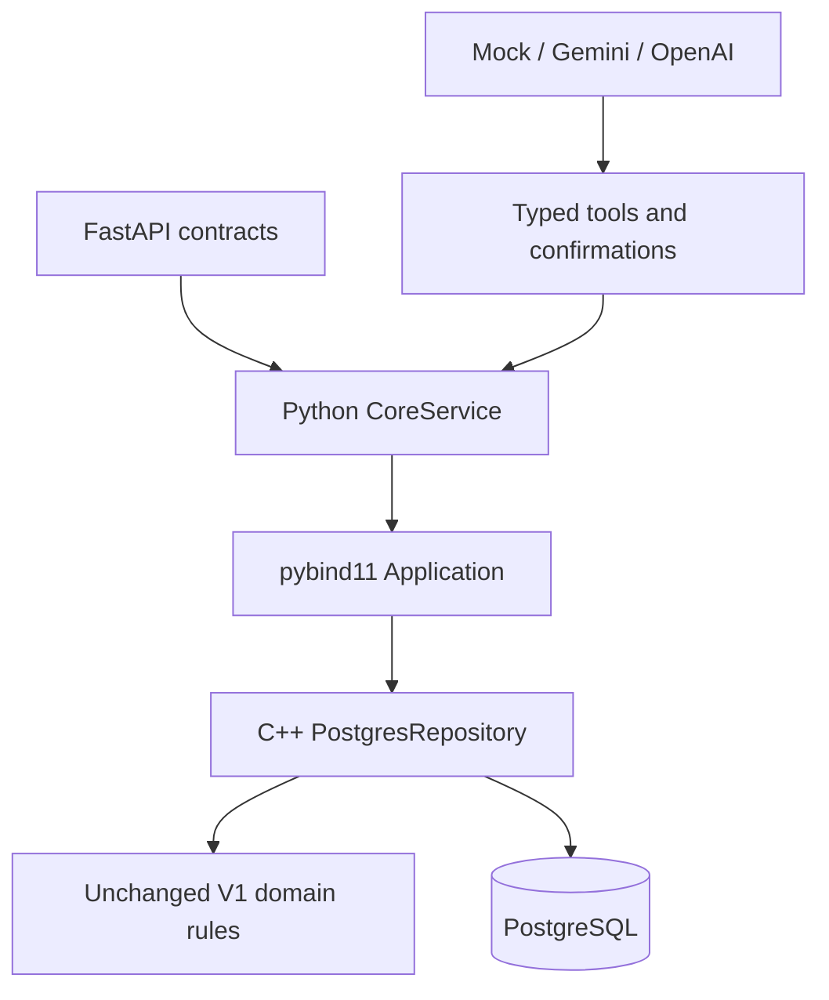

# LibraCore V2 completion report

Delivery date: 25 October 2026 (Asia/Kolkata).

## A. Frozen V1 baseline

The uploaded V1 archive was extracted into a separate V2 workspace. Before any
source change, clean CMake configuration/build succeeded, CTest passed 2/2,
the main suite passed, the fault suite passed seven scenarios and 58 allocation
failure points, and the complete demo exited successfully. Baseline logs are in
`docs/verification-v2/baseline-*.txt`.

All original `src/*.cpp`, tests, demo and benchmark files remain byte-for-byte
identical to the uploaded V1. Academic filenames and compatibility identifiers
are retained. Three domain headers add only the trusted persistence friend.

## B. Architecture



A modular application, not microservices. Python orchestrates; C++ owns
business rules; PostgreSQL owns persistent state. The full design is documented
in `V2_ARCHITECTURE.md`.

## C. Database

Implemented Compose with a persistent named PostgreSQL volume, localhost-only port
binding and health checks. Two checksummed transactional migrations create the
normalized resource/details/authors/vendor/user/department/budget/loan/order/event
schema and indexes. Money uses BIGINT minor units. Quota/title usage remains
queryable. Request idempotency receipts and immutable vendor snapshots are the
only flexible JSON documents. Primary/foreign/unique/check constraints provide
relational safeguards. Trigram and full-text indexes support persistent search.

Migration SQL parsed successfully (37 statements). This is static syntax evidence,
not proof that PostgreSQL accepted or executed the schema. See
`V2_DATABASE_SCHEMA.md` for table mappings and `sql-static-review.txt` for checks.

## D. C++ additions

| Component | Files | Responsibility |
|---|---|---|
| IRepository / PostgresRepository | include/libracore/Repository.h; src/v2/PostgresRepository.cpp | Named application operations, RAII transactions, parameterized SQL, search, state persistence |
| PersistenceAccess | include/libracore/Mapping.h | Trusted restoration of holdings, exact budget usage/title counts, loan/history state and counters |
| Resource/Money/record/loan mapping | src/v2/Mapping.cpp | Structured conversion, six subtypes, UTC dates, strict integer boundaries and round trips |
| Python Application | bindings/module.cpp | Native dictionaries/lists, structured error envelopes, GIL release during C++ execution |
| Mapping regression executable | tests/v2/test_mapping.cpp | Offline subtype, Money, date, loan and record validation |
| PostgreSQL regression executable | tests/v2/test_postgres.cpp | Real repository reconstruction, pricing and rejected-write invariants; invoked by DB fixture |

The C++17 persistence library, both new test executables and pybind11 module all
compile. Existing warnings remain enabled; no warning suppression was added.

## E. Persistence and transactions

Each operation opens a fresh connection/transaction and restores transaction-local
V1 objects. A PostgreSQL singleton row lock serializes domain writes across
clients. Resource loading is restricted to the operation's IDs; search filters and
pagination execute directly in PostgreSQL. Budget/title usage and acquisition
history are hydrated for domain operations. The transaction persists inventory,
finance, loans, new immutable records/events, counters and idempotency receipts
before one commit. SQL errors roll back the entire unit of work.

A cancellation appends its record; original purchase history is unchanged.
Fiscal rollover calls V1 `nextYear`, archives the old year and closes prior-year
cancellation. Same-key/same-input retries reuse the saved result; changed input
with the same key conflicts. No automatic write retry occurs.

## F. Python integration

`python/libracore_api` contains typed settings, schemas, service adapter, FastAPI
factory, AI modules, deployment migration/seed tools and a persistent benchmark.
The package targets Python 3.11+; executed here on Python 3.12. The lock file pins
all installed runtime/test dependencies. Setup installs into `.venv` and compiles
the extension; `pip check` passes. Configuration reads environment, `.env` and
`.env.example` without overwriting an existing private file.

## G. API

Implemented resource search/lookup/availability/CRUD; quote/check/submit/batch/
get/cancel acquisitions; borrow/get/partial-or-full return/user loans; user and
department creation; budget creation/quota/rollover; vendor offers; budget,
department, acquisition and lending reports; events; health; assistant messages
and explicit confirmations. The full endpoint/parameter inventory is in
`V2_API.md`. Errors use stable codes, safe messages and structured details.
OpenAPI generation is tested. Direct native integer validation rejects fractional,
boolean and overflowing financial/quantity input instead of truncating it.

## H. AI

Mock, Gemini (`google-genai`) and OpenAI adapters normalize SDK results into the
same ToolCall structure. Auto selection is OpenAI key → Gemini key → Mock.
Explicit providers fail clearly if misconfigured. SDK clients initialize only
when selected. Fourteen typed tools have READ/WRITE/HIGH_RISK classification;
all AI purchases/cancellations are conservatively high-risk. High-risk proposals
use expiring, session-bound, single-use tokens. Confirmation is not an LLM tool;
parameters cannot be replaced at confirmation. Tool output schemas validate
application results. Assistant wording is deterministic around authoritative tool
results, rather than unsupported model claims. No live AI calls were made.

## I. Executed verification

- Clean V2 configuration and complete build: PASS, zero compiler warnings.
- CTest: 3/3 PASS (V1 main, V1 fault injection, new mapping tests).
- Original main suite: PASS; all original tests preserved.
- Fault suite: PASS, seven scenarios / 58 allocation-failure points.
- Python: **80 passed, 31 explicitly skipped for unavailable PostgreSQL**.
- Native bindings, API/service doubles, SDK response doubles, Mock provider,
  configuration and confirmations all executed.
- Full original console demo: PASS, 354 output lines.
- V1 10K, 100K and 1M benchmarks: PASS.
- Both migration files and 60 literal repository SQL statements plus combined
  search: parsed. This is static review, not database execution.
- Shell scripts: syntax checked. Setup/test correctly exit 1 with a clear Docker
  prerequisite message in this environment.
- Dependency consistency and private-key scan: PASS.

Evidence is retained in `docs/verification-v2/`. Historical V1 release logs remain
unchanged and are not confused with this V2 verification.

## J. Required test matrix and unexecuted checks

| Required group | Status | Evidence / remaining work |
|---|---|---|
| V1 main tests | PASS | Native suite and CTest |
| V1 fault tests | PASS | 7 scenarios / 58 points |
| Migration execution | NOT EXECUTED — ENVIRONMENT BLOCKED | Syntax parsed; Docker PostgreSQL unavailable |
| Repository integration | NOT EXECUTED — ENVIRONMENT BLOCKED | Real C++/Python tests implemented; native DB executable compiled |
| Transaction rollback | NOT EXECUTED — ENVIRONMENT BLOCKED | Five DB trigger-failure scenarios implemented |
| Concurrency | NOT EXECUTED — ENVIRONMENT BLOCKED | Lending, spending, quota, cancellation and duplicate-ID races implemented |
| pybind offline tests | PASS | Native Money/resource conversion, input bounds and redacted connection errors |
| Python configuration/schema tests | PASS | Environment, validation, isolation and secret-redaction checks |
| Provider selection | PASS | Required auto/explicit cases |
| Gemini adapter | PASS | Injected SDK response/error doubles; declaration conversion |
| OpenAI adapter | PASS | Injected SDK response/error doubles |
| Mock provider | PASS | Deterministic supported intents |
| Tool tests | PASS | Allowlist, typed parameters/results and one-operation limit |
| Confirmation tests | PASS | Session binding, expiry, replay/concurrency and write-disable behavior |
| FastAPI offline endpoints | PASS | Service-double dispatch, OpenAPI and assistant flow |
| Error contracts | PASS | Validation/domain/DB/unexpected-error redaction |
| DB-backed FastAPI/end-to-end | NOT EXECUTED — ENVIRONMENT BLOCKED | Full real-stack workflow implemented |
| 10K DB benchmark | NOT EXECUTED — ENVIRONMENT BLOCKED | Loader/timing script implemented |
| 100K DB benchmark | NOT EXECUTED — ENVIRONMENT BLOCKED | Loader/timing script implemented |

No Docker CLI, socket or remote daemon is available here. PostgreSQL was not
installed on the host, and no alternative database engine was substituted. Client
headers/libraries were extracted locally to compile against libpqxx 7.8.1 and
libpq 16.15. This confirms compileability but not runtime integration.
Live Gemini/OpenAI testing is optional, was not enabled, and is not part of the
mandatory local database verification.

## K. Local verification commands

Run in Ubuntu WSL with Docker Desktop integration enabled, after extracting the
archive to `~/projects/LibraCore` and placing your existing `.env` there:

```bash
sudo apt-get update
sudo apt-get install -y build-essential cmake python3 python3-venv python3-dev \
  libpq-dev libpqxx-dev nlohmann-json3-dev pkg-config unzip
cd ~/projects/LibraCore
chmod +x scripts/*.sh
./scripts/setup_v2.sh
./scripts/test_v2.sh
./scripts/benchmark_v2.sh 10000
./scripts/benchmark_v2.sh 100000
LLM_PROVIDER=mock ./scripts/demo_v2.sh
```

`V2_LOCAL_VERIFICATION.md` includes exact extraction, environment, migration,
component-build, troubleshooting and optional live Gemini commands. No source
editing is required. A failed full test or any database skip blocks release freeze.

## L. Concurrency status

Database row locking, transactional idempotency and a unique cancellation index
are implemented. Tests use barriers and independent C++ connections; expected
results are exactly one successful last-copy loan, affordable purchase, quota
purchase or cancellation; identical requests produce one committed effect.
These database assertions are not reported as passed until run locally.
The independent in-memory confirmation race test passed here.

## M. Measured benchmarks

These are **V1 in-memory** measurements from the final built executable, in
milliseconds. Each row is one run; not an average or a PostgreSQL result.

| Resources | Generation | 10K ID lookups | Title | Author | Combined | Year range |
|---:|---:|---:|---:|---:|---:|---:|
| 10,000 | 26.0643 | 4.875 | 4.432 | 1.884 | 4.319 | 0.949 |
| 100,000 | 272.913 | 14.204 | 55.434 | 22.045 | 69.368 | 27.282 |
| 1,000,000 | 2938.330 | 16.347 | 549.856 | 215.340 | 534.166 | 147.697 |

Environment: GCC 13.3.0, CMake 4.4.4, Linux x86_64, CMAKE_BUILD_TYPE unset
(no explicit optimization flags). CPU details are recorded in the environment
log. Benchmarks consume result counts and report generation separately.

Benchmark results are environment-specific and are intended for comparative
project evaluation rather than universal performance claims. Persistent timings
must be measured by the supplied scripts on the local Docker environment; no
numbers are invented here.

## N. Security and cleanliness

Private uploaded environment files were preserved and excluded from the source
archive. `.gitignore` ignores `.env*` except `.env.example`, builds, binaries and
Python/editor caches. The delivered source was scanned against actual uploaded
API-key bytes without printing them. Configuration errors hide raw input values;
API/SDK/DB exception handlers avoid credential-bearing messages. SQL values are
parameterized; only a fixed internal sort allowlist contributes SQL fragments.
No raw database method or confirmation tool is available to AI. Normal pytest
forces Mock and blocks external SDK client construction.

The input ZIP has no `.git` metadata. Git status/diff/ls-files were attempted and
reported unavailable; an archive comparison verified modifications instead.
No commit, tag, push or history rewrite was performed. Build outputs, dependency
packages, virtual environments, caches and private files are not in the ZIP.

## O. Files modified and created

| Existing file | Change / reason |
|---|---|
| .gitignore | Exclude private environment variants and Python/build/editor artifacts |
| CMakeLists.txt | Optional V2 dependencies/library/binding/mapping/DB-test targets; V1-only build preserved |
| README.md | V2 architecture, setup, API/AI/test/benchmark use and honest release status |
| include/bookmgmt/Acquisition.h | PersistenceAccess friend for historical state and counter restoration |
| include/bookmgmt/Budget.h | PersistenceAccess friend for exact relational usage/title restoration |
| include/bookmgmt/Catalog.h | PersistenceAccess friend for holdings, loans and counter restoration |

New files include `.env.example`, Compose, two SQL migrations, two V2 public
headers, mapping/repository implementation, bindings, two C++ test files, the
Python package and four test modules plus fixtures, pinned dependencies, seven
shell scripts, all seven required V2 documents, a preserved V1 README and evidence
logs. `V2_FILE_INVENTORY.md` lists every added/modified deliverable path.

## P. Intentional limitations and remaining verification

- Docker-backed integration and persistent benchmarks still require local WSL execution.
- Trusted localhost backend; no authentication, authorization, frontend or public deployment.
- Global row lock and per-operation history/budget hydration limit write throughput.
- Single API worker for in-memory pending confirmations; restart discards proposals.
- Append-oriented history is unbounded; no archival/retention policy yet.
- Cross-currency aggregate totals reject mixed currencies; no exchange conversion.
- UTC second precision at the C++ mapping boundary, external years 1970–2200.
- No vector/embedding retrieval; pgvector and semantic AI features deferred to V2.x.
- Runtime LLM fallback remains disabled; provider failures are explicit.

## Q. Verdict

V2 IMPLEMENTATION COMPLETE — LOCAL DATABASE VERIFICATION REQUIRED
