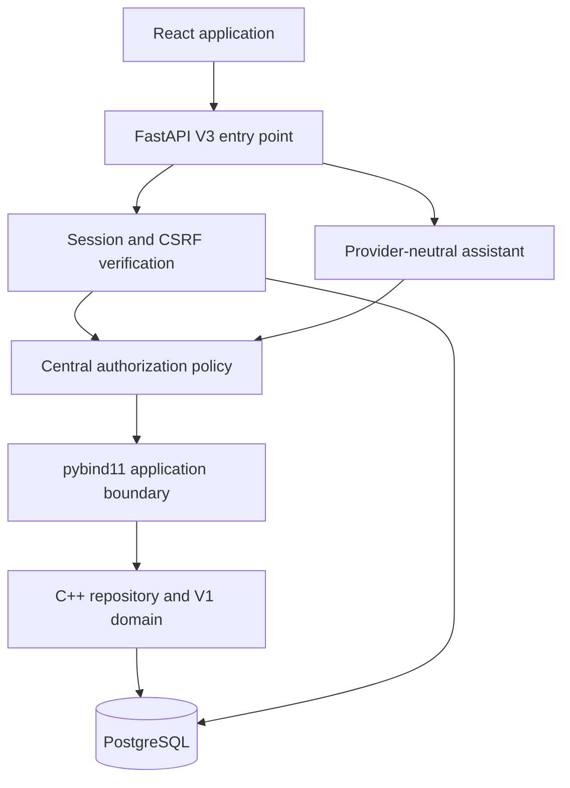

# LibraCore V3 architecture

V3 extends the uploaded frozen V2 implementation. Original V1 algorithms and tests remain intact. V2 migrations 001 and 002 are unchanged; migration 003 adds identity storage. C++ is still the only authority for prices, taxes, budgets, quotas, purchases, cancellation, borrowing and returns.

## Boundaries

`libracore_api.v3.main:create_app` is the secure entry point. The ordinary `python -m libracore_api.run` delegates to it, as do all V3 scripts and containers. The V2 `main.create_app` remains an internal legacy factory used to preserve its contract tests; **never deploy that factory directly**. V3 wraps its service with `AuthorizedService`, adds authentication middleware and extends the same `/api/v1` routes.

`ContextVar` carries the authenticated principal through asynchronous middleware and FastAPI's worker threads. Permissions map named operations to one centralized policy. Unknown operations are denied. Ownership and department scopes are checked using stored entities, never a caller's claimed ownership. Search/resource outputs remove vendor offers for roles without vendor permission.

Python SQL handles identity, sessions and security events in `v3/auth.py`, plus nonfinancial cover metadata in `v3/media.py`. Financial and inventory SQL remains C++. This is an intentional distinction from V2's blanket “no runtime Python SQL” convention: authentication is an orchestration concern, not a duplicate domain model.

## Transaction boundaries

The native repository retains V2's `app_state FOR UPDATE` lock and immutable idempotency receipts. V3 replaces per-call connections with up to four RAII leases per repository instance. Each transaction is destroyed before its connection returns to the pool. Broken connections are discarded; pool exhaustion fails after five seconds. Connection setup defaults to a five-second timeout. Lock/statement timeouts remain 10/30 seconds. There are no automatic write retries.

Authentication has a separate psycopg pool, minimum zero/maximum four, a five-second acquisition/connect timeout and a 30-second statement timeout. Lifespan shutdown closes the auth pool. Native pool lifetime follows the application object. No domain state is cached in either pool.

A protected domain call takes a user-row lock in an auth transaction, rechecks the session, performs authorization and holds that lock until the native call returns. Password resets, role changes and revocations take the same row lock. An already authorized request may finish before revocation; subsequent calls fail. This gives a defined ordering, not rollback of a completed authorized request. Administrators changing another account lock user IDs in sorted order.

## Application structure

| Area | Responsibility |
|---|---|
| `v3/security.py` | Argon2id, token hashes, CSRF comparisons, bounded rate limiting |
| `v3/auth.py` | Credential/session transactions, revocation and security history |
| `v3/policy.py` | Role matrix, object ownership, department scope, AI filtering |
| `v3/main.py` | Secure HTTP entry point and auth/admin routes |
| `ai/` | Existing Mock/Gemini/OpenAI adapters and confirmation store |
| `frontend/src/features/` | Feature-specific screens and workflows |
| `frontend/src/components/` | Shared controls, feedback, charts and layout |
| `src/v2/PostgresRepository.cpp` | Domain transactions, pools, searches and structured summaries |

## Performance

Resource ID cursor pagination uses `resource_id > after` with stable ID ordering and zero offset. Other sorts retain existing offset contracts. The events feed uses descending event IDs and `event_id < before`. These use existing primary keys; no speculative indexes or extra infrastructure were introduced. Legacy event ordering remains unchanged.

Quotes now include pre-tax amount, tax, selected vendor and budget snapshots obtained by invoking existing C++ calculations on transaction-local copies. Preview calculations do not mutate holdings or persistent budgets. Dashboard requests are bounded summary/list queries; resource cards include authors/offers from the native structured resource result rather than individual browser lookups.

The global domain lock and history hydration still limit write throughput. Pooling is a resource-management improvement, not a claim of horizontal scalability.

## Final polish extension

See [V3 polish engineering notes](V3_POLISH_ENGINEERING.md) for additive migration 004, media isolation, exact identifier ranking, structured presentation fields and opening-stock semantics. Migration 003 and both V2 migrations are unchanged from the authoritative uploaded V3 archive. C++ financial formulas and V1 source files are unchanged.
